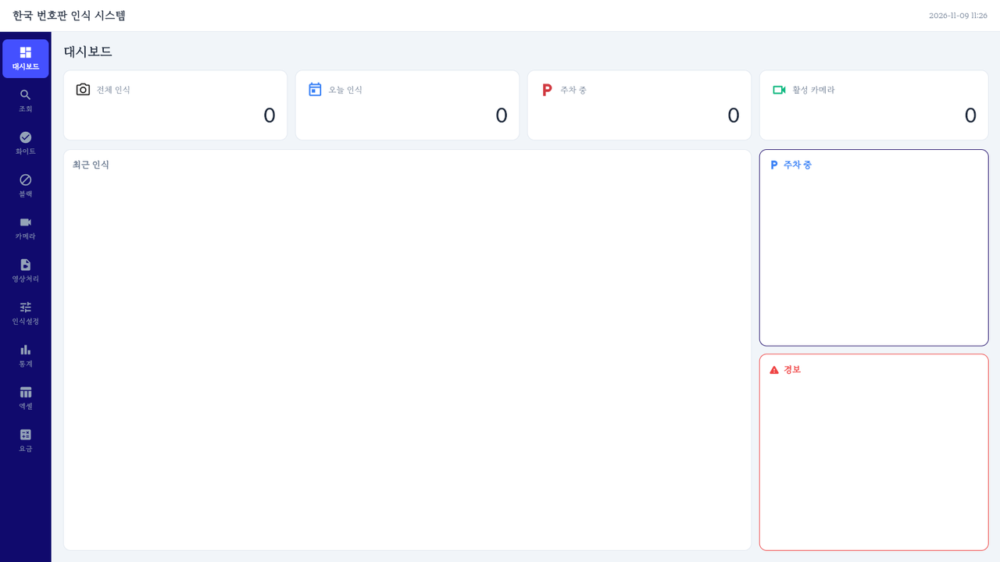
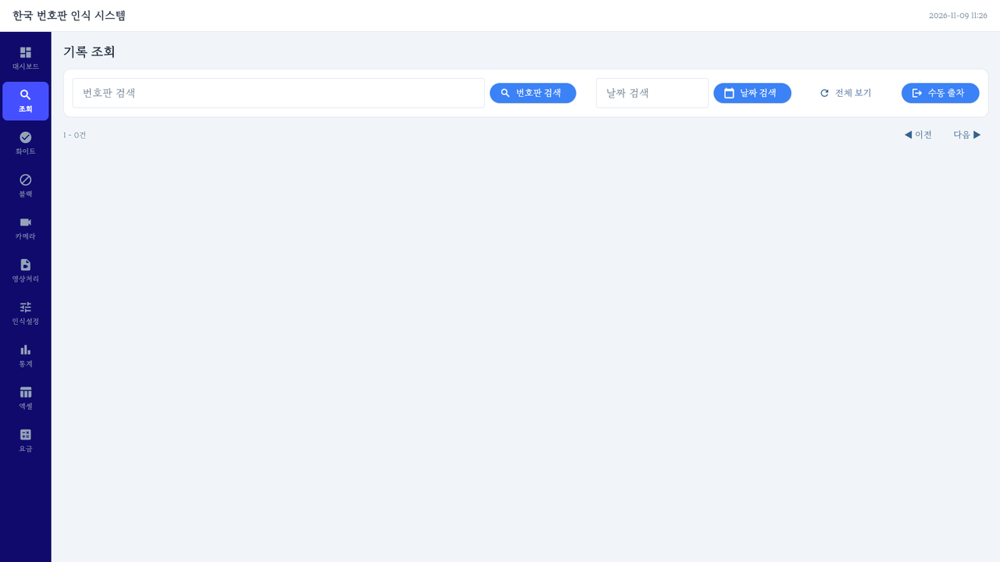
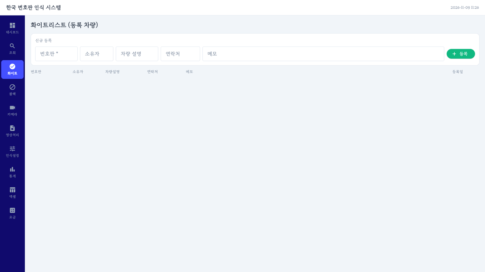
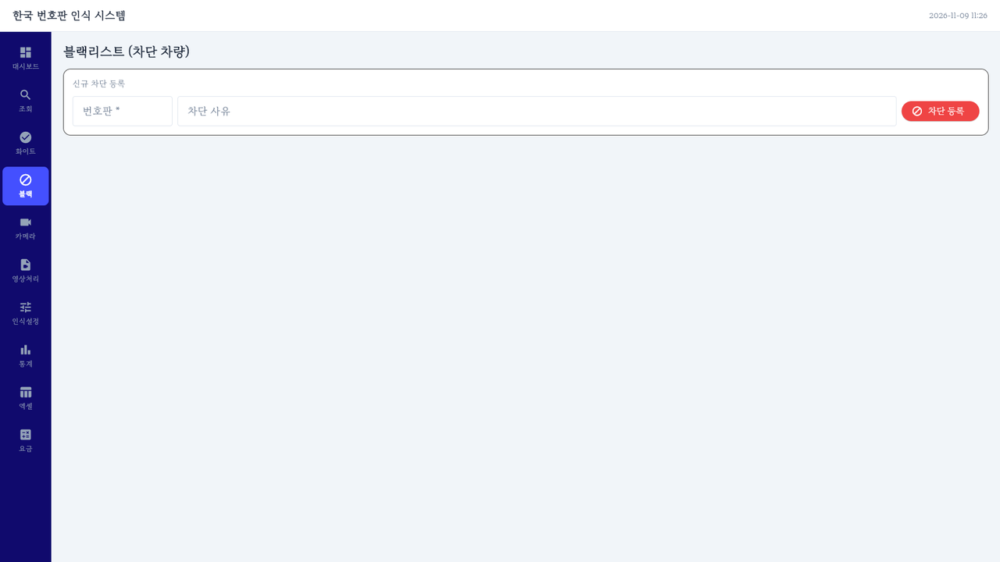
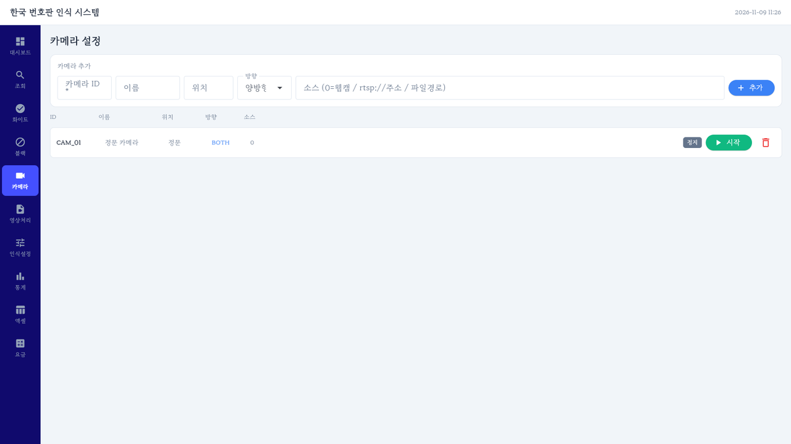
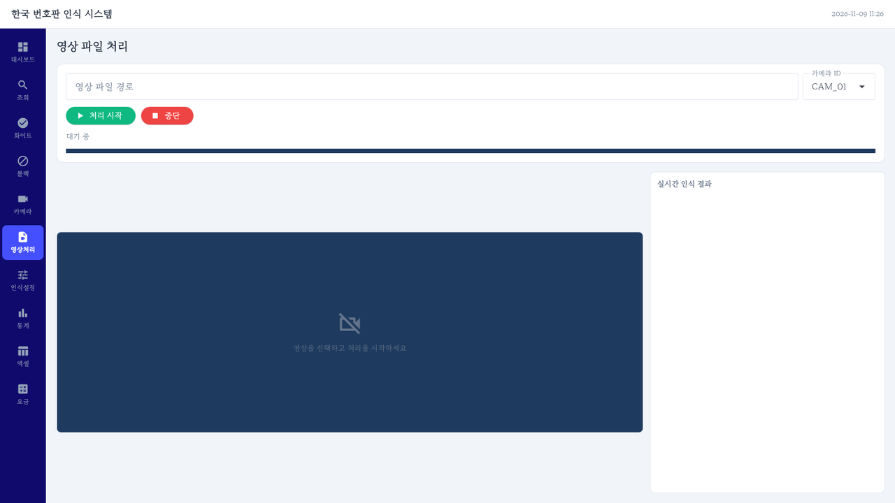
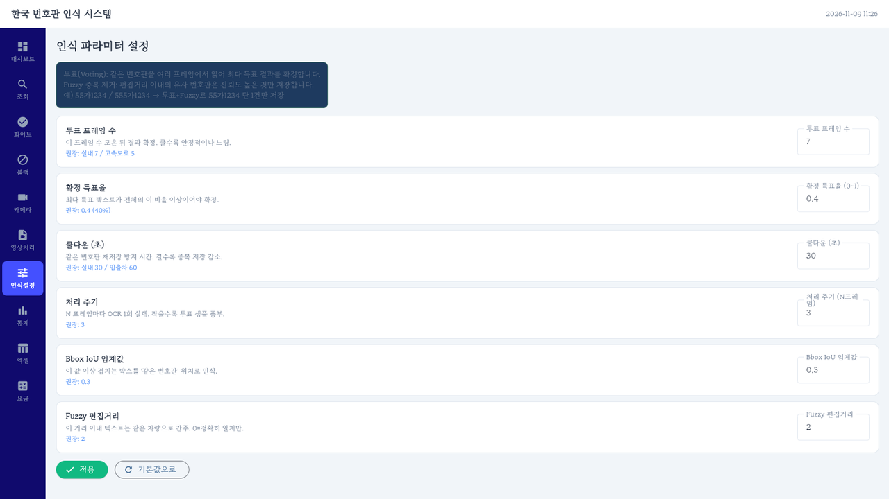
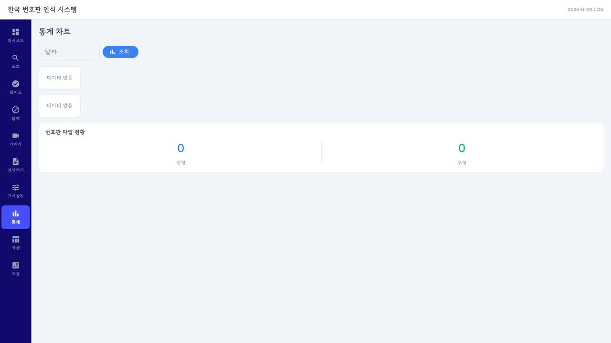
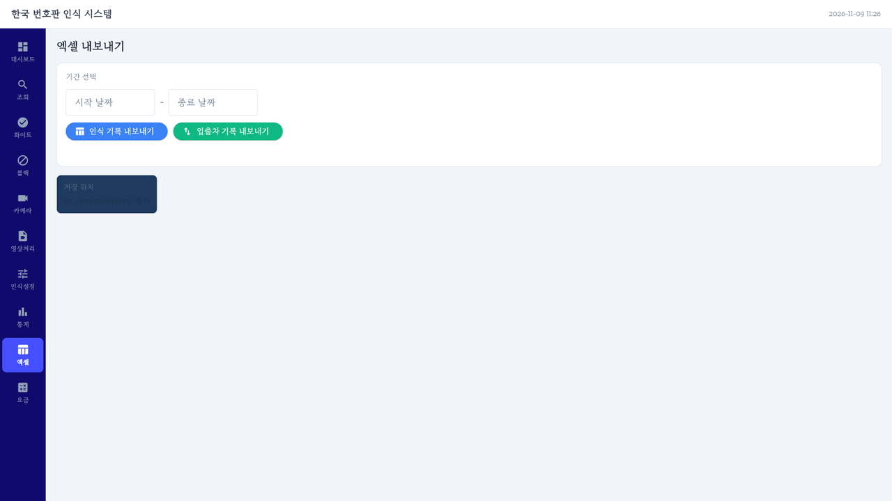
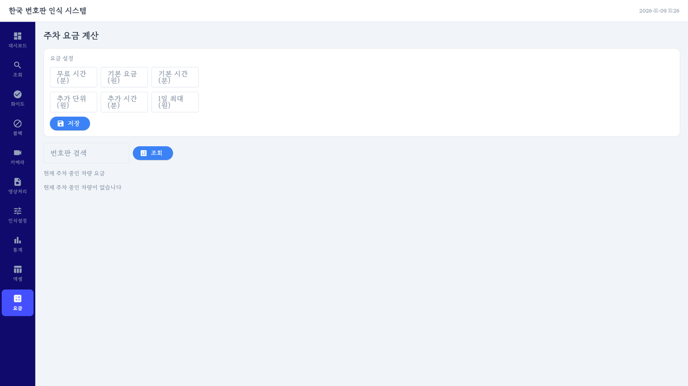

# lpr_system · 번호판 인식 주차 관리 프로그램

OpenCV 번호판 검출, EasyOCR 문자 인식, SQLite 기록 파이프라인에 Flet 데스크톱 화면, 입출차 관리, 차단 차량 경보, 주차 요금, 엑셀 내보내기를 더한 소스 폴더. 지원 번호판 종류, `plate_logs` 스키마, 파이프라인 개요는 [루트 README](../README.md) 참고.

## 파일

| 파일 | 역할 |
|---|---|
| `app.py` | Flet 화면 진입점. 대시보드, 조회, 화이트, 블랙, 카메라, 영상처리, 인식설정, 통계, 엑셀, 요금 10개 메뉴 |
| `pipeline.py` | 프레임 단위 인식 파이프라인. 투표 확정, 편집거리 중복 제거, DB·이미지 저장, 입출차 기록. 영상 파일 처리 `process_video`, 카메라 스트림 스레드 `start_camera_thread` |
| `detector.py` | MOG2 모션 감지, 윤곽선 기반 번호판 후보 검출, HSV 색상 분류, 원근 보정과 OCR 전처리 |
| `ocr_engine.py` | EasyOCR 한국어·영어 Reader 초기화, 숫자·한글 허용 문자 인식, 번호판 정규식 검증 |
| `database.py` | `parking.db` 연결과 테이블 생성, 인식 기록·화이트리스트·블랙리스트·입출차·카메라 설정 CRUD, 기간·시간대별 조회 |
| `alert_system.py` | 블랙리스트 차량 인식 시 경보음 재생과 화면 팝업 콜백 호출, 같은 차량 60초 안 중복 알림 방지 |
| `parking_fee.py` | 입차 시각부터 현재 또는 출차 시각까지의 주차 요금 계산 |
| `excel_export.py` | 기간별 인식 기록·입출차 기록을 `exports/` 폴더에 `.xlsx`로 저장 |
| `demo.py` | EasyOCR 없이 합성 번호판 이미지로 색상 분류, 전처리, DB 저장 확인 |
| `assets/fonts/MyFont.ttf` | Flet 화면 기본 글꼴 |
| `parking.db` | 실행하며 쌓인 SQLite DB 파일 |
| `logs/` | `pipeline.py`가 날짜별로 남기는 `system_YYYYMMDD.log` |

번호판 이미지 폴더 `plate_images/`는 `pipeline.py`를 불러올 때, `exports/`는 엑셀을 처음 내보낼 때 자동 생성.

## DB 테이블

| 테이블 | 내용 |
|---|---|
| `plate_logs` | 번호판 인식 기록 |
| `whitelist` | 등록 차량. 루트 README 컬럼에 `phone`, `memo`, `expires_at` 추가 |
| `blacklist` | 차단 차량 번호와 사유 |
| `entry_exit_log` | 번호판별 `ENTRY`·`EXIT` 이벤트, 카메라, 시각, 이미지 경로 |
| `camera_config` | 카메라 ID, 이름, 위치, 방향, 영상 소스, 사용 여부. 첫 실행 시 `CAM_01` 정문 카메라 기본 등록 |

## 인식 처리 순서

1. `PROCESS_EVERY_N` 3프레임마다, MOG2 배경 차분으로 움직임이 있을 때만 처리
2. CLAHE, 가우시안 블러, Otsu 이진화, 닫기 연산 후 윤곽선 추출. 면적 800~45000, 가로세로 비율 1.8~6.5, 볼록 비율 0.4 이상 후보만 남기고 NMS 적용
3. HSV 색상 점수로 `WHITE`, `GREENYELLOW`, `YELLOW`, `BLUE` 분류. `GREENYELLOW`만 구형 `OLD`
4. 꼭짓점 4개로 근사되면 원근 보정, 320×80 정규화. 파란 번호판은 일반 이진화, 나머지는 반전 이진화
5. EasyOCR 신뢰도 0.50 이상 결과만 이어 붙여 신형·구형·소형 정규식으로 번호 추출
6. 같은 위치 후보를 7개 모아 40% 이상 득표한 번호로 확정
7. 30초 안에 편집거리 2 이내 번호가 있으면 같은 차량으로 보고 신뢰도가 더 높을 때만 이전 기록을 지우고 교체
8. DB와 번호판 이미지 저장. 카메라 방향이 `BOTH`면 직전 이벤트의 반대로 입차·출차 기록
9. 화이트리스트 `GRANTED`, 블랙리스트 `BLACKLIST`, 그 외 `UNKNOWN` 판정. 화면에서는 `BLACKLIST`일 때 경보 호출

투표 프레임 수, 득표율, 쿨다운, 처리 주기, IoU 임계값, 편집거리는 인식설정 메뉴에서 실행 중 변경 가능.

## 주차 요금 기본값

| 항목 | 값 |
|---|---|
| 무료 시간 | 10분 이하 |
| 기본 요금 | 최초 30분 1,000원 |
| 추가 요금 | 이후 10분마다 500원 |
| 상한 | 15,000원 |

요금 메뉴에서 값을 바꿔 현재 주차 중인 차량 요금 조회.

## 실행 방법

```bash
pip install opencv-python numpy easyocr flet openpyxl
cd lpr_system
python app.py
```

- 화면 시작 시 DB 초기화와 EasyOCR 모델 로딩을 함께 진행. 첫 실행에서는 EasyOCR 모델 내려받기 시간 필요.
- 루트 README의 `query_tool.py`, `requirements.txt`, `samples/`와 `pipeline.py` 명령행 실행은 현재 폴더에 없는 구성. 영상 파일 처리는 영상처리 메뉴에서 진행.
- `demo.py`는 `database.py`에 없는 `query_statistics`를 불러오므로 현재 그대로는 실행 불가.
- `parking_fee.py`는 `Optional`을 import하지 않아 Python 3.13 이하에서는 불러오기 단계에서 오류. 로그에 남은 실행 환경은 Python 3.14.

## 실행 화면

Python 3.14에서 `app.py`를 DB 파일이 없는 첫 실행 상태로 띄워 메뉴 10개를 차례로 찍은 화면. Flet 웹 모드, 브라우저 화면 1600×900. 첫 실행이라 인식 기록·등록 차량·통계는 비어 있고, 카메라는 기본 등록되는 `CAM_01` 정문 카메라 1대.



*대시보드. 전체 인식, 오늘 인식, 주차 중, 활성 카메라 카드와 최근 인식·주차 중·경보 목록.*

| 조회 | 화이트 |
|---|---|
|  |  |
| **블랙** | **카메라** |
|  |  |
| **영상처리** | **인식설정 · 투표 7프레임, 득표율 0.4, 쿨다운 30초, 처리 주기 3프레임** |
|  |  |
| **통계** | **엑셀** |
|  |  |
| **요금** | |
|  | |

요금 메뉴의 요금 설정 칸 6개는 기본값이 `make_field`의 힌트 문구 자리로 전달되어 빈 칸으로 표시.
